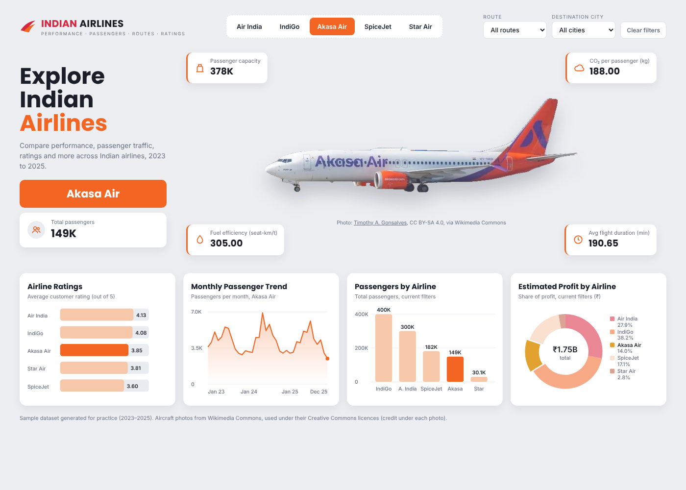

# Indian Airlines Dashboard

An interactive dashboard comparing five Indian airlines (Air India, IndiGo, Akasa Air, SpiceJet, Star Air) on passengers, capacity, fuel efficiency, CO₂ per passenger, flight duration, ratings and estimated profit. Pick an airline from the top tabs and the aircraft, airline name and KPI cards switch to that carrier, while the comparison charts keep all airlines and highlight the selected one.

**Live demo:** https://kalpana-zala.github.io/indian-airlines-dashboard/

## What's in this repo

| Path | Contents |
| --- | --- |
| `docs/index.html` | Self-contained interactive dashboard (served by GitHub Pages) |
| `data/Fact_Flights.csv` | 11,554 sample flights, 2023–2025 (route, passengers, capacity, fuel, CO₂, duration, profit) |
| `data/Dim_Airline.csv` | Airline dimension with rating, brand colour and plane image URL |
| `images/*.png` | Transparent aircraft cut-outs, one per airline (raw URLs used in Power BI) |
| `scripts/generate_data.py` | Python script that generates the sample dataset |
| `scripts/measures.dax` | All DAX tables and measures for the Power BI build |

## How the dynamic parts work (Power BI)

- **Airline tabs:** button slicer on a disconnected `Airline Selector` table, single select.
- **Changing aircraft image:** `Dim_Airline[PlaneImageURL]` set to *Image URL* data category; an Image visual reads the `Selected Plane URL` measure through conditional formatting (fx).
- **KPI cards:** `Sel …` measures use `TREATAS` to apply the selected airline without filtering the comparison charts.
- **Highlight in charts:** `Bar Color` measure returns orange for the selected airline, peach for the rest.
- **Route / destination:** dropdown slicers on `Fact_Flights`.

## Tech

Power BI (DAX, data modelling), Python (pandas, NumPy), HTML/CSS/JavaScript (hand-drawn SVG charts).

## Data and image credits

The dataset is **synthetic**, generated for practice; it does not represent real airline performance.

Aircraft photos are from Wikimedia Commons under CC BY-SA 4.0, with backgrounds removed:

| Airline | Photo | Author |
| --- | --- | --- |
| Air India | [VT-EXI, Airbus A320neo](https://commons.wikimedia.org/wiki/File:VT-EXI_-_Airbus_A320-251N_-_Air_India_-_VGHS.jpg) | Md Shaifuzzaman Ayon |
| IndiGo | [VT-IJD, Airbus A320neo](https://commons.wikimedia.org/wiki/File:IndiGo_Airbus_A320neo_VT-IJD.jpg) | Md Shaifuzzaman Ayon |
| Akasa Air | [VT-YAO, Boeing 737 MAX](https://commons.wikimedia.org/wiki/File:Akasa_Air_VT-YAO_Chennai_Jul25_A7CR_06029.jpg) | Timothy A. Gonsalves |
| SpiceJet | [VT-MXX, Boeing 737 MAX 8](https://commons.wikimedia.org/wiki/File:VT-MXX_-_Boeing_737_MAX_8_-_SpiceJet_-_MSN_60184_-_VGHS.jpg) | Md Shaifuzzaman Ayon |
| Star Air | [Embraer E175](https://commons.wikimedia.org/wiki/File:Star_Air_Embraer_E175_VT-GSH_landing_at_VOBL.jpg) | Sandeepthompil |

The edited images in `images/` are shared under the same licence, [CC BY-SA 4.0](https://creativecommons.org/licenses/by-sa/4.0/). Airline names and liveries belong to their owners; this is an independent portfolio project.

## Author

Kalpana Zala · Power BI and Python Developer
